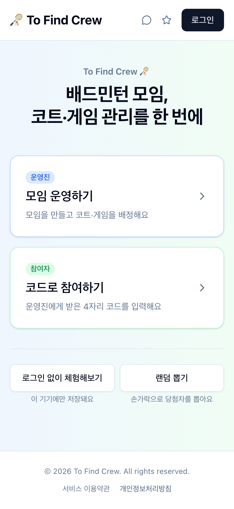
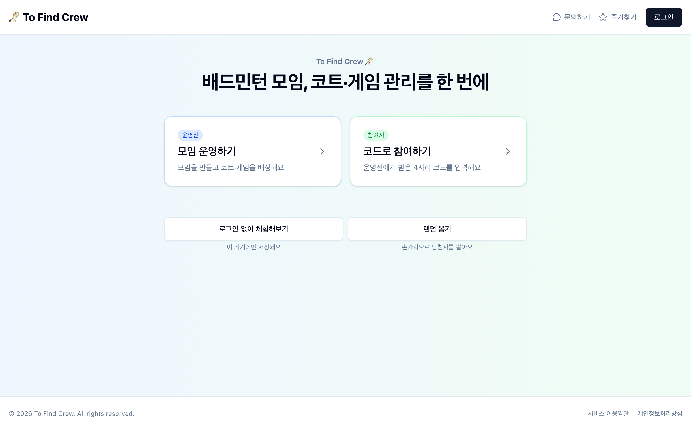
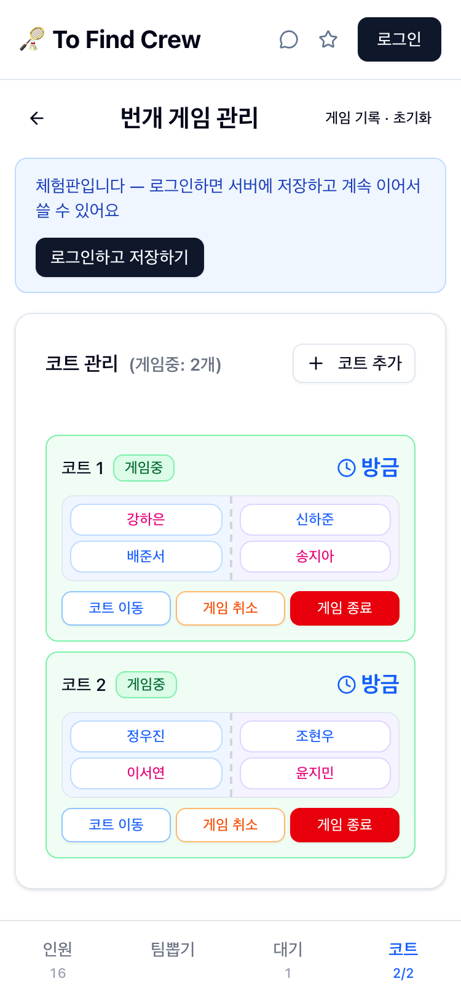
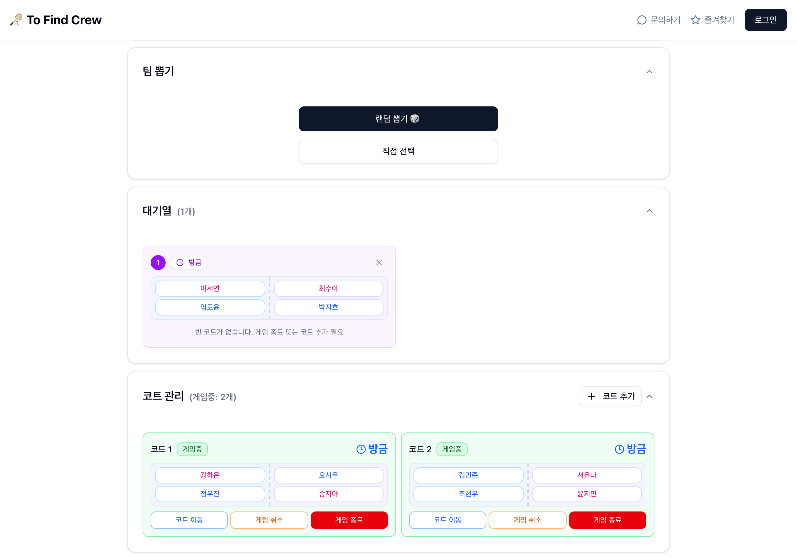
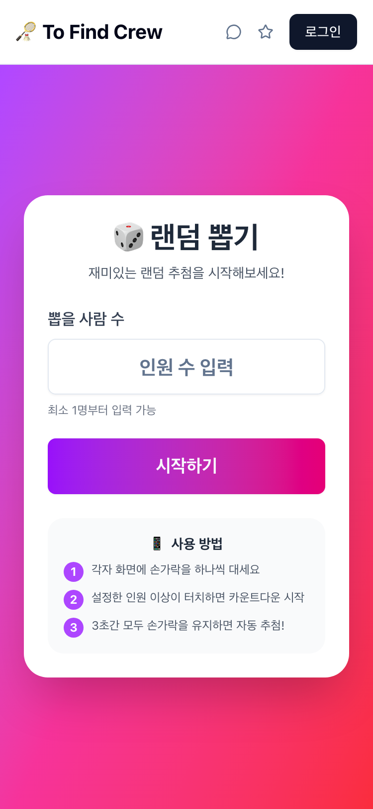

# To Find Crew 🏸

배드민턴 동호회 현장 게임 운영 도구입니다. 코트 배정, 대기열, 팀 구성을 실시간 보드 하나로 관리합니다.

🔗 https://to-find-crew.vercel.app

## 📸 화면

**홈**

<table><tr>
<td></td>
<td></td>
</tr></table>

**게임 매니저 보드**

<table><tr>
<td></td>
<td></td>
</tr></table>

**랜덤 뽑기**



## ✨ 주요 기능

### 게임 매니저 (`/game-manager`)

- 로그인 없이 쓰는 체험 모드. 데이터는 브라우저 localStorage에 저장됩니다.
- 로그인하면 localStorage의 선수 명단을 서버 세션으로 옮길 수 있습니다.

### 모임(세션) 관리 (`/badminton/*`)

- `/badminton/create`: 세션 만들기, `/badminton/edit/[id]`: 세션 수정
- `/badminton/join`: 코드로 참여, `/badminton/invite/[code]`: 초대 링크로 비회원(게스트) 참여
- `/badminton/my-sessions`: 내 세션 목록
- `/badminton/favorites`: 비회원용 즐겨찾기 세션 (localStorage 전용)

### 실시간 보드 (`/badminton/[id]`)

- 운영자 보드: 코트 배정, 대기열, 팀 뽑기(직접 선택 포함), 경기 기록
- 공동 운영자 관리
- 참여자용 읽기 전용 실시간 현황판
- 내 차례가 되면 웹 푸시 알림 ("내 차례예요!")

### 기타

- `/random-picker`: 화면을 동시에 터치해 무작위로 뽑는 멀티터치 랜덤 뽑기 (모바일용)
- 로그인: Kakao, 이메일(매직 링크 / 비밀번호). `/profile`에서 프로필 수정
- PWA 지원, `/terms`, `/privacy` 페이지

## 🧰 기술 스택

- Next.js 15 (App Router), React 19, TypeScript
- Tailwind CSS, Radix UI, framer-motion
- Supabase (Database, Auth, Realtime, Storage 아바타 이미지)
- Sentry (에러 모니터링), Vercel (배포 + Vercel Analytics)
- web-push (푸시 알림), next-pwa
- Playwright (e2e)

## 🚀 시작하기

### 필수 요구사항

- Node.js 26.x
- pnpm 9 (`packageManager`: pnpm@9.15.3)

### 설치 및 실행

```bash
pnpm install       # 의존성 설치
pnpm dev           # 개발 서버 (Turbopack)
pnpm build         # 빌드
pnpm start         # 프로덕션 실행
pnpm lint          # ESLint (src, e2e, playwright.config.ts)
pnpm test:e2e      # Playwright e2e
```

로컬 환경 변수 파일(`.env.local`)이 필요합니다 (아래 환경 변수 참고).

### e2e 테스트

- 처음 한 번 브라우저를 설치합니다: `pnpm exec playwright install chromium`
- 로그인이 필요 없는 화면(`/`, `/game-manager`)만 자동화되어 있습니다. `mobile`(375x812)과 `desktop`(1280x800) 두 프로젝트로 실행됩니다.
- 로그인/DB 쓰기가 필요한 화면(운영자 보드, 현황판, 초대/참여 등)은 수동으로 확인합니다.

## 🔑 환경 변수

`.env.local`에 설정합니다. 값은 저장소에 포함하지 않습니다.

| 이름                            | 필수/선택    | 용도                                                         |
| ------------------------------- | ------------ | ------------------------------------------------------------ |
| `NEXT_PUBLIC_SUPABASE_URL`      | 필수         | Supabase 프로젝트 URL                                        |
| `NEXT_PUBLIC_SUPABASE_ANON_KEY` | 필수         | Supabase anon 키                                             |
| `NEXT_PUBLIC_APP_URL`           | 필수(로그인) | Kakao/이메일 로그인 후 `/auth/callback` 리다이렉트 기준 URL |
| `NEXT_PUBLIC_VAPID_PUBLIC_KEY`  | 선택         | 웹 푸시 구독용 VAPID 공개 키                                 |
| `VAPID_PRIVATE_KEY`             | 선택         | 웹 푸시 발송용 VAPID 개인 키 (서버 전용)                     |
| `VAPID_SUBJECT`                 | 선택         | VAPID subject (`mailto:` 또는 URL)                           |
| `NEXT_PUBLIC_SENTRY_DSN`        | 선택         | Sentry DSN (클라이언트/서버/엣지 공통)                       |
| `SENTRY_ORG`                    | 선택         | Sentry 조직 (소스맵 업로드)                                  |
| `SENTRY_PROJECT`                | 선택         | Sentry 프로젝트 (소스맵 업로드)                              |
| `SENTRY_AUTH_TOKEN`             | 선택         | Sentry 소스맵 업로드 인증 토큰 (Sentry 빌드 플러그인이 읽음) |

`NEXT_PUBLIC_VERCEL_ENV`는 Vercel 시스템 변수입니다. Sentry 환경 구분에 쓰이며, Vercel 프로젝트 설정에서 "Automatically expose System Environment Variables"를 켜야 클라이언트에 노출됩니다.

## 🗄️ 데이터베이스

- `supabase-schema.sql`이 스키마의 기준 문서입니다. 마이그레이션 도구 없이 Supabase 대시보드 SQL 에디터에 직접 붙여넣어 적용하므로, 실제 DB와 어긋날 수 있습니다. 확인이 필요하면 DB를 먼저 조회하세요.
- 추가 전용 원칙: 기능 추가는 새 `CREATE TABLE`로만 하고, 기존 테이블의 `ALTER`/`DROP`은 사전 합의 없이 하지 않습니다.
- Realtime이 필요한 새 테이블은 publication 등록과 `REPLICA IDENTITY FULL`이 추가로 필요합니다. 자세한 내용은 `CLAUDE.md`를 참고하세요.

### 배드민턴

- `badminton_sessions`: 세션
- `session_participants`: 로그인 사용자 참여자
- `guest_participants`: 비회원 참여자
- `session_organizers`: 공동 운영자
- `session_participant_overrides`: 세션 한정 참여자 표시 정보 덮어쓰기
- `board_player_state`: 보드의 선수별 상태(참석/활동 등)
- `courts`: 코트
- `board_games`: 보드 경기/대기열
- `push_subscriptions`: 웹 푸시 구독
- `teams`, `team_members`, `games`: 보드 도입 이전 구조. 코드에서는 `teams`만 세션 조회 API에서 읽고, 나머지는 쓰이지 않습니다 (레거시).

### 공통

- `users`: 사용자 프로필 (컬럼 단위 SELECT 권한 제한 있음)

### 비전 단계 설계

- `crews`, `crew_members`, `meetings`, `meeting_participants`, `messages`: 크루 매칭 플랫폼용 스키마. 현재 코드에서는 사용하지 않습니다.

## 📁 프로젝트 구조

```
src/
  app/          # 라우트 (badminton, game-manager, random-picker, auth, profile, terms, privacy, api)
  components/   # auth, badminton, game-manager, layout, legal, random-picker, ui
  contexts/     # AuthContext
  hooks/        # 보드 realtime(useBoardRealtime, useBoardSpectator), useGameManager 등
  lib/          # supabase, push, monitoring 등
  types/        # 타입 정의
  utils/        # 보드 스냅샷, 팀 뽑기, 즐겨찾기 등
e2e/            # Playwright 테스트
docs/gotchas/   # 개발 시 주의사항 문서
supabase-schema.sql
```

## 📚 개발 문서

- `CLAUDE.md`: 프로젝트 정체성, 스키마/Git/테스트 규칙 등 개발 컨벤션
- `docs/gotchas/`: 특정 영역을 건드리기 전에 읽어야 할 주의사항 (로그인 마이그레이션, 보드 컨벤션, 에러 모니터링 등)

## 🌱 장기 비전: 크루 매칭 플랫폼

- **목적**: 관심사가 비슷한 사람들과 크루를 만들고 모임을 주선할 수 있는 플랫폼
- **아이디어**: 크루 생성/가입, 모임(번개) 관리, 실시간 채팅, 위치 기반 검색
- 단기적으로는 배드민턴 현장 운영 도구에 집중합니다.

## 📄 라이선스

MIT
